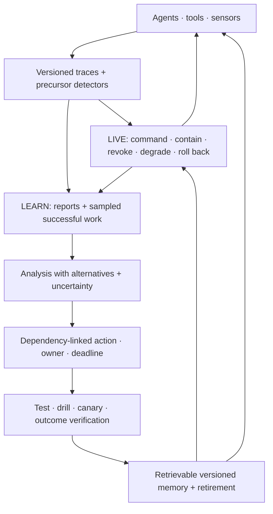

# Candidate 011: dual-loop operational assurance

**Stage:** 1 — multi-agent fault-injection falsification

**Status:** held systems composition; not an accepted project claim

**Primary question:** does an explicit live containment loop connected to a
separate longitudinal learning loop reduce tail containment time and recurrence
severity beyond a mature SRE and incident-management stack at equal authority,
compute, storage, interruption, and human-time budgets?

## Candidate boundary

The live loop and learning loop solve different problems:

1. **Live operation** detects, acknowledges, contains, degrades, revokes,
   escalates, rolls back, and restores under a deadline.
2. **Longitudinal learning** retains multi-perspective traces, samples
   precursors and successful adaptations, evaluates competing explanations,
   binds an accepted finding to a versioned change and test, verifies the
   outcome, retrieves it when applicable, and retires it when stale.

Containment without learning permits recurrence. Documentation without a fast
authority path permits damage before explanation is complete. The candidate is
the measured interface between the loops, not an organizational vocabulary.

## Candidate loop

## Observation model

Raw report count is not a safety metric. Over one declared exposure interval,

$$
N_{\mathrm{report}} = N_{\mathrm{precursor}}
p_{\mathrm{detect}}p_{\mathrm{report}}p_{\mathrm{retain}},
$$

where both $N$ terms are event counts and every $p$ is a dimensionless
stage-conditional probability. The factorization is diagnostic, not an
independence assumption. Severity, workload, identity, instrumentation,
incentives, and enforcement may change every factor.

The learning funnel is reported cohort by cohort:

$$
N_{\mathrm{verified}} = N_{\mathrm{report}}
p_{\mathrm{triage}}p_{\mathrm{analyze}}p_{\mathrm{action}}p_{\mathrm{verify}}.
$$

Completion at one stage does not establish effectiveness at the next. The
experiment records attrition reasons and verified outcome change, not ticket
closure.

## Latency model

For a fault onset defined by the simulator,

$$
T_{\mathrm{contain}} = T_{\mathrm{detect}} + T_{\mathrm{classify}}
+ T_{\mathrm{authorize}} + T_{\mathrm{act}}.
$$

Every term is measured in seconds. Report p50, p95, and p99. Faster authority
may increase false stops, contradictory commands, or expert load, so latency is
never reported alone.

## Task family

Use modular-agent environments with injected:

- correlated tool and model faults;
- conflicting or delayed observations;
- an unavailable coordinator or specialist;
- changing objectives during response;
- communication overload and alert floods;
- authority-gradient cases where a low-status module holds decisive evidence;
- precursors with a known exposure denominator; and
- recurrence after renamed components, changed versions, and shifted symptoms.

## Arms

1. free-form multi-agent chat and logging;
2. one fixed central supervisor;
3. mature SRE telemetry, on-call roles, runbooks, IAM, circuit breakers,
   canaries, postmortems, action tracking, and searchable memory;
4. deterministic interlocks plus ordinary incident command;
5. the dual-loop composition; and
6. a topology-reduced ceiling that removes the injected dependency when
   possible but is not eligible to hide lost task utility.

## Equalization

Hold constant:

- model versions, context, tools, and permissions;
- total compute, bytes moved, retained bytes, and wall energy;
- human or expert minutes;
- response deadlines and interruption budget;
- maximum containment and revocation authority;
- protected-test and drill count;
- simulator exposure and post-event labels; and
- topology and common-mode fault distribution.

## Experimental tracks

1. **Incident topology:** vary coupling, opacity, slack, common-mode failure,
   handoffs, and spans of control.
2. **Challenge and escalation:** vary authority gradient, expert availability,
   acknowledgement rules, false-stop cost, and irreversible-action deadline.
3. **Near-miss observation:** compare complete telemetry, protected reports,
   punitive attribution, and trajectory mining against known precursors.
4. **Adaptive procedure:** compare static text, executable checks, and recorded
   expert deviation under routine and rare changed-interface conditions.
5. **Memory across versions:** reintroduce causal families after renaming and
   migration, then measure applicability-triggered retrieval and stale harm.
6. **Success sampling:** allocate a fixed analysis budget across failures,
   near misses, ordinary success, and demanding successful adaptations.

## Measurements

Report raw axes:

- p50/p95/p99 containment and restoration time;
- unsafe actions and consequence before containment;
- false stops and lost task utility;
- contradictory commands and handoff information loss;
- communication, expert, reviewer, storage, and energy cost;
- precursor recall conditional on exposure;
- report duplication, privacy leakage, and strategic reporting;
- verified corrective-change rate;
- recurrence severity and time to applicability-triggered retrieval;
- stale-lesson harm and retirement latency; and
- retained bytes per prevented recurrence.

## Confirmatory analysis and statistical plan

The confirmatory unit is an independently generated incident episode, including
its precursor exposure, live response, restoration, learning record, later
applicability opportunities, and recurrence window. Pair arms on the same fault,
topology, alert stream, authority gradient, objectives, and expert-availability
schedule. Cluster repeated episodes that share a causal family, system version,
runbook, memory lineage, operator or expert, or simulator world. Hold out entire
fault families, dependency topologies, version migrations, symptom renamings,
authority structures, report-policy regimes, and future recurrence periods;
random alerts or log entries from one incident cannot cross splits.

Preregister paired contrasts of the dual-loop composition against the mature
SRE stack, deterministic interlocks plus incident command, and fixed central
supervision. Report paired effects and simultaneous intervals for unsafe
consequence before containment, p99 containment time, restoration time,
false-stop utility loss, verified corrective-change rate, recurrence severity,
stale-lesson harm, communication/expert cost, and retained bytes per prevented
recurrence. Time outcomes use survival or restricted-mean analysis with the
episode deadline stated; precursor recall and recurrence use their actual
exposure denominators. Hierarchical or cluster-resampled intervals preserve
fault-family, version, site, and repeated-expert dependence. Simulator,
timestamp, energy-meter, and expert-time uncertainty remain separately
reported.

Use a frozen gatekeeping order: no excess unsafe action or false-stop harm;
noninferior containment/restoration under the declared task margins; lower
recurrence or faster applicability-triggered retrieval; then lower human,
communication, storage, or energy cost. Task margins are preregistered from the
service contract. Control multiplicity across the six experimental tracks,
eligible comparator contrasts, and primary tail/outcome family with a
hierarchical family-wise procedure. Publish raw effects and intervals even when
the adjusted decision does not pass, and do not replace the outcome vector with
one incident score.

Episodes not contained or restored by the observation horizon are right-
censored for time analysis and retain their full consequence and availability
loss. Missing telemetry, unavailable experts, unacknowledged handoffs,
unverified corrective actions, absent recurrence opportunities, privacy-
redacted reports, and failed retrieval are explicit states. “No recurrence” is
not credited when follow-up exposure is absent or censored. Preregister
selection and sensitivity analyses for strategic reporting and informative
loss to follow-up; assigned incidents remain in all service denominators.

Roles, authority transfers, acknowledgement deadlines, challenge rules,
containment triggers, retrieval ranking, applicability tests, memory versioning,
expiry, corrective-action verification, and closure criteria are tuned on
development/validation incidents and frozen before confirmation. Apply the
frozen policy to every held-out incident and recurrence opportunity, including
novel or unsupported states that require abstention or fallback. The
topology-reduced ceiling remains descriptive and cannot determine a pass.

## Required ablations

- disconnect the learning loop from live retrieval;
- retain only the accepted incident narrative, dropping conflicting traces;
- close actions without outcome verification;
- remove version and dependency links;
- remove expiry and retirement;
- let escalation transfer authority without acknowledgement or deadline;
- sample only failures; and
- replace protected reporting with complete automatic telemetry.

## Kill criteria

Reject the composition if:

- the mature SRE stack matches containment, recurrence, and retrieval at no
  greater human, compute, storage, energy, or false-stop cost;
- explicit roles increase coordination traffic or tail containment;
- near-miss mining raises report volume without denominator-adjusted precursor
  recall or verified changes;
- dependency-linked memory retrieves more stale lessons than useful ones;
- adaptive procedure overrides create more consequential bypasses than they
  prevent fixation failures;
- topological simplification or deterministic interlocks dominate at matched
  task utility; or
- results depend on uncharged staffing, authority, telemetry, or labels.

## Promotion rule

### Interruption and resumption gate

Live response must count interruption duration, resumption latency, rework,
stress/effort measures, and person-minutes rather than treating acknowledgement
as effective intervention. A human responder must receive timely actual and
pending mode, effective authority, changed state, executable containment or
recovery, a resumption cue, and evidence that the intended state changed
([C-396](../../research/claims.md#c-396)–[C-416](../../research/claims.md#c-416)).

The candidate remains a composition of existing principles unless the link
between live response and versioned learning produces a reproducible frontier
gain across at least two materially different fault topologies. A failure
merges each useful component into ordinary SRE, incident command, provenance,
and maintenance practice.

## Evidence links

- [High-reliability organizations audit](../../research/audits/2026-08-05-high-reliability-organizations-incident-learning.md)
- [C-173](../../research/claims.md#c-173)–[C-185](../../research/claims.md#c-185)
- [P-002](../../research/principle-registry.md#p-002--local-autonomy-with-exception-escalation)
- [P-003](../../research/principle-registry.md#p-003--temporary-trace-before-commitment)
- [P-009](../../research/principle-registry.md#p-009--maintenance-plane)
- [P-013](../../research/principle-registry.md#p-013--externalized-shared-state)

## Supply-chain operations-research track

**Domain status.** Operational-closure refinement only. See the
[supply-chain audit](../../research/audits/2026-08-05-supply-chain-operations-research.md#exact-candidate-refinements).
Evidence: [C-627](../../research/claims.md#c-627),
[C-659](../../research/claims.md#c-659)–[C-678](../../research/claims.md#c-678).

**Trace contract.** Bind forecast vintage, accepted demand, inventory and
capacity evidence, allocation, route, delivered service, and service-definition
version to an implemented and verified policy change. Retrieval must be
relevance-triggered; a postmortem is not loop closure.

**Strongest OR nulls.** Event-sourced operational ledgers, inventory
reconciliation, ordinary corrective-action tracking, verified policy
deployment, reliability/recovery scheduling, searchable runbooks, and standard
incident/postmortem practice.

**Matched-budget test.** Replay paired repeated and near-neighbor disruptions
with identical forecasts, inventory error, ownership handoff, partial
remediation, compute, human hours, and intervention authority; compare no
postmortem, narrative-only, retrieval-only, verified policy update, and this
candidate.

**Service and recovery measurements.** Report action closure, policy-test pass,
next-event unit fill/OTIF, recurrence, backlog-clearance hours, reserve
readiness, delivered-service error, retrieval precision, and human hours.

**Rejection gate.** Reject if no executable policy changes, if the change is
not tested and deployed, if retrieval is untargeted, or if ordinary corrective-
action tracking plus event-sourced evidence matches next-event service and
recovery.

## Burden-qualified contestable-decision track

The [legal evidence/procedure audit](../../research/audits/2026-08-05-legal-evidence-procedure.md#candidate-coverage-and-exact-refinements)
binds every review to preserved issue, record version, review standard,
permitted scope, prejudicial-error rule, disposition, remedy, successor version,
and reopening/finality state. A reversal is not automatically a first-stage
error label, and affirmance is not proof of correctness.

Evidence: [C-679](../../research/claims.md#c-679)–[C-704](../../research/claims.md#c-704).

Inject selected review, unpreserved issues, deferential versus de-novo scopes,
harmless errors, incomplete remedies, remand loops, reviewer error, and changed
rules. Report protected-outcome correction, time under wrong effect, review and
remedy latency, recurrence, human effort, bytes, and joules. Reject if ordinary
versioned issue tracking plus independent review/recompute matches the frontier
or if the learning loop trains directly on reversal as ground truth.

## Care-continuity and unfinished-work track

The
[nursing, care, and health-services audit](../../research/audits/2026-08-21-nursing-care-health-services.md)
adds a falsification track in which locally correct completed work can coexist
with necessary work left undone across shifts, agents, or service boundaries.
This is a workload and transition test, not a clinical deployment.
Evidence: [C-1241](../../research/claims.md#c-1241)–[C-1248](../../research/claims.md#c-1248).

Each obligation must carry a version, applicability rule, owner, proposed
receiver, prerequisites, service deadline, acceptance state, unresolved
questions, and completion or exception evidence. Sender dispatch does not imply
receiver acceptance; acknowledgement does not imply effective action; ticket
closure does not imply delivered service. Informational continuity, plan
continuity, persistent-actor continuity, and verified service are scored as
different axes.

Run the five frozen synthetic tracks specified in the audit:

1. bilateral handover with omission, stale state, ambiguous ownership, receiver
   synthesis, read-back, and version mismatch;
2. unfinished necessary work under feasible and deliberately infeasible load;
3. same-agent versus rotating-agent continuity with full records, summaries,
   stable plans, and no-record controls;
4. noisy deterioration detection joined to finite response queues and verified
   effect; and
5. changing preference, access, refusal, correction, and remedy through a
   transition.

The strongest null is an event-sourced typed workflow with ordinary scheduling,
acknowledgement, schema validation, calibrated sequential detection, case
management, and Candidate 014 support records. Equalize source observations,
packet bytes, calls, question count, response authority, reserve, person-minutes,
elapsed time, and joules. Report item-level omission, harm-weighted tardiness,
unaccepted responsibility, downstream consequence, false escalation, queue
displacement, preference/authority violations, human burden, bytes, and energy.

Reject this refinement if the ordinary workflow stack matches the complete
frontier; if benefit comes from hidden staff, labels, records, authority, or
future information; if persistent-agent gain disappears with complete records
and a stable plan; or if improved alarm discrimination fails to improve time to
verified effect under finite response capacity.
