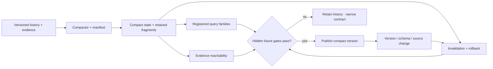

# Candidate 017: contract-preserving semantic compaction

**Stage:** 1 — hidden-query, invalidation, and rollback falsification

**Status:** held storage composition; not an accepted project claim

**Primary question:** can a system shrink long observation, action, version,
and evidence histories while preserving declared query, evidence, rollback,
uncertainty, and invalidation contracts better than snapshots, materialized
views, key compaction, lossless compression, and cold archives at equal complete
budget?

## Candidate statement

The compactor may preserve a finite registered contract, not “all future
meaning.” For history $H$, compact state $Z=C_\phi(H)$, query family
$\mathcal Q$, invalidation family $\mathcal I$, and evidence relation $L$,
require

$$
\Pr_{q\sim\mathcal D_Q}[d(q(H),q(Z))>\epsilon_q]\leq\delta,
$$

$$
\operatorname{Recall}_L(Z)\geq r_L,
\qquad
\operatorname{Success}_{\mathcal I}(Z)\geq r_I.
$$

$d$ and $\epsilon_q$ use the query's native unit; $\delta$, $r_L$, and $r_I$
are dimensionless. The byte reduction

$$
\rho_B=1-\frac{|Z|+|M_Z|}{|H|+|M_H|}
$$

includes manifests, indexes, retained fragments, replicas, and backups. The
query distribution has a preregistered out-of-distribution split.

## Lifecycle

## Strongest nulls

1. full version/event history with ordinary indexes;
2. current-state snapshot plus retained suffix log;
3. materialized views for registered queries;
4. key-based log compaction and tombstones;
5. lossless compression and deduplication;
6. TTL/retention tiers with a full cold archive;
7. extractive summaries retaining cited source spans; and
8. Candidate 014's observation contract without learned compaction.

All arms receive equal hot/cold physical bytes, index and metadata bytes,
maintenance bandwidth, compaction work, human policy time, and rollback horizon.

## Matched-budget and resource parity

Replay identical histories, correction times, schema and source changes,
retention obligations, corruption events, and registered requests through all
arms. Equalize hot and cold byte-years, replicas and backups, index and metadata
bytes, ingestion and maintenance bandwidth, compaction and query compute,
measured energy, restore horizon, authorized source access, and curator,
reviewer, and engineering person-minutes. Charge manifest generation,
dependency retention, migration, failed rebuilds, legal holds, and verified
deletion to the arm that requires them. Do not let an arm obtain a longer raw
history or additional query work after hidden queries are revealed.

## Experiment

Use streams containing factual corrections, late observations, conflicting
sources, policy changes, tool outcomes, model updates, privacy deletion, and
legal holds. Freeze the compactor before generating hidden future queries,
invalidation requests, rollback requests, and rare safety/audit questions.

Measure physical bytes, compaction joules, foreground p99 interference,
query-native error and calibration, evidence-link precision/recall, rollback
horizon, invalidation precision/recall, erasure success, audit reconstruction
time, and degradation after summary or source-fragment corruption.

Every compact version emits a machine-readable manifest naming the query,
evidence, uncertainty, retention, deletion, and rollback obligations it claims.
Unsupported questions must be rejected rather than reconstructed from invented
detail.

## Outcomes and measurements

Report results by stream, compact version, registered query family, source and
schema regime, obligation type, and corruption stratum:

| Outcome | Unit and denominator |
| --- | --- |
| physical storage and metadata | bytes and byte-years at each tier, including replicas and backups |
| compaction, maintenance, query, and restore energy | joules at the declared system boundary |
| foreground interference and reconstruction time | p99 seconds and seconds per completed request |
| registered-query error | each query's declared native unit and tolerance |
| query calibration and contract coverage | dimensionless calibration measure and covered-query fraction |
| evidence-link and invalidation performance | precision and recall fractions over registered obligations |
| rollback horizon and restore completion | seconds of recoverable history and completed restores per request |
| deletion or erasure success | verified fraction of registered deletion requests, with residual bytes reported |
| missing representation dependencies | count per compact version |
| unsupported-query behavior | correct abstentions, erroneous answers, and source-recovery requests per query |
| human lifecycle work | curator, reviewer, and engineering person-minutes per version |

Query-native outcomes are not converted to a common score unless the conversion
and its sensitivity analysis were registered before compaction.

## Confirmatory analysis and statistical plan

Pair arms on the complete input history, source arrival times, corrections,
schema transitions, legal obligations, corruption schedule, and query seeds.
Freeze each compactor and manifest before generating hidden future queries,
invalidations, rollback requests, and deletion tests. Hold out complete query
families, future time blocks, sources, schema versions, and workload families;
the independent unit is a stream or independently generated history, with
queries clustered inside it.

The primary comparison is against the strongest snapshot, materialized-view,
lossless-compression, or cold-archive null under the matched resource vector.
Estimate paired differences and uncertainty with a stream-level hierarchical
model or cluster bootstrap. Report the storage–maintenance–energy–query vector,
contract-violation rates, calibration, and tail reconstruction behavior; do not
declare a win from byte reduction alone.

Preregister one primary obligation or query contrast per workload family. Gate
secondary frontier claims on those contrasts and use a declared multiplicity
procedure across query families, corruption conditions, and obligations. Rare
safety, evidence, deletion, and rollback obligations remain separately visible
even when their intervals are wide.

An unregistered question counts as a correct abstention only when the frozen
manifest says it is unsupported or requires source recovery. Timeouts and
unfinished restore or rollback operations are right-censored at the registered
horizon; unavailable sources, missing dependencies, failed erasure
verification, and corrupted compact state remain adverse outcomes. Report
missingness by arm and cause and use bounded sensitivity analyses rather than a
complete-case primary analysis.

Apply the promotion and retirement rules ex ante to held-out estimates and
uncertainty intervals. Query tolerances and acceptance margins must come from
the registered use contract, measurement resolution, or baseline variability,
not from the observed candidate result. New query families discovered during
analysis require a new compact version and test split.

## Ablations

1. Remove the manifest.
2. Train and test on the same query families.
3. Omit rare safety and evidence questions.
4. Exclude metadata, source fragments, or backups from $\rho_B$.
5. Preserve query output but remove evidence links.
6. Preserve current queries but remove invalidation.
7. Preserve average error but omit tail or subgroup error.
8. Change source/schema versions without revalidation.
9. Corrupt the compact summary without a retained fallback.
10. Compare only with raw unindexed history.

## Promotion and kill rules

Advance only if one frozen policy improves the storage–maintenance-energy–query
frontier across at least three workload families and two hardware profiles,
while rare obligations, evidence reachability, rollback, invalidation, and
failure degradation meet preregistered thresholds.

Retire when snapshots, views, cold archive, or Candidate 014 match it; metadata
and compute erase the gain; exact future queries must be known; current-state
by key is the only preserved contract; or summary drift destroys reproducibility.

## Evidence links

- [Database and storage audit](../../research/audits/2026-08-05-databases-storage.md)
- [C-325](../../research/claims.md#c-325)–[C-342](../../research/claims.md#c-342)
- [Candidate 009](009-graded-assurance-envelopes.md)
- [Candidate 011](011-dual-loop-operational-assurance.md)
- [Candidate 014](014-versioned-observation-contract.md)

## Supply-chain operations-research track

**Domain status.** Query-contract refinement, not an inventory-compression
analogy. See the
[supply-chain audit](../../research/audits/2026-08-05-supply-chain-operations-research.md#exact-candidate-refinements).
Evidence: [C-627](../../research/claims.md#c-627),
[C-659](../../research/claims.md#c-659)–[C-678](../../research/claims.md#c-678).

**Preserved queries.** Declare before compaction every order/inventory history
needed to reconstruct provenance, lead-time and delay distributions, lost-sales
censoring, expiry/condition, returns and recovery yield, disruption/recovery,
and service-definition versions.

**Strongest OR/storage nulls.** Lossless event logs, snapshots, materialized
views, cold archive, ordinary compression with retained raw fragments,
age-structured inventory, service/censoring models, and repairable-item
ledgers.

**Matched-budget test.** Replay identical demand, expiry, return, disruption,
and metric-version histories across complete log, snapshot/archive, ordinary
compression, and candidate compaction; equalize storage bytes, query compute,
maintenance, rebuild time, and retained metadata.

**Service and recovery measurements.** Report query error, unreconstructable
service decisions, lost-sales and lead-time estimation error, fill/OTIF
reconstruction, expiry/condition mistakes, recovery-yield error,
backlog-clearance error, restore hours, bytes, joules, and human audit hours.

**Rejection gate.** Reject if required future queries must be guessed after
compression, if service/recovery evidence cannot be reconstructed, or if a
complete log plus snapshots/cold archive matches the storage–query–maintenance
frontier.

## Designated-community and representation-dependency track

The [library and archival-science audit](../../research/audits/2026-08-05-library-archival-information-science.md)
adds a stricter preservation boundary. A byte sequence and query manifest are
not sufficient when the future interpreter also needs a format, schema,
vocabulary, identity mapping, authority record, software dependency, unit
convention, access grant, or practiced procedure.

For every compact version, add:

1. the designated human or agent community and a versioned capability profile;
2. closure over required format, rendering, schema, vocabulary, authority,
   software, unit, and cryptographic dependencies;
3. registered queries with output unit, tolerance, evidence obligations,
   authorization, and time horizon;
4. migration and vocabulary mapping manifests with split, merge, contested,
   loss, supersession, reviewer, and rollback/source-recovery fields;
5. a typed outcome for unregistered queries: covered, source-recovery required,
   or unsupported; and
6. lifecycle accounts for description, metadata, replicas, dependencies,
   tests, curator/reviewer work, migration, restore, holds, and deletion.

The matched E-LIS-1 arms are full retained history; ordinary versioned
repository plus query regression; OAIS/PREMIS-style designated-community and
representation package; and learned compaction with the same package and
tests. Equalize stored byte-years, ingestion and migration joules,
engineering/curator/reviewer hours, query latency, restore horizon, and
authorized source access.

Perturb schemas, vocabularies, identities, dependencies, interpreters, and
required deletion. Measure registered-query error in native units, evidence-
link survival, calibration, reconstruction seconds, missing dependencies,
unregistered-query regret, privacy/authorization failures, and the complete
lifecycle vector.

The [mathematical contract](../../math/query-registered-preservation.md) and
[query-registered preservation diagram](../../concept/07-cross-domain-convergence.md#preserved-bits-are-not-preserved-meaning)
define the state. Retire this track if ordinary packaging, versioned schemas and
vocabularies, retained source, and query-regression tests match the frontier.
It refines Candidate 017; it is not an archival-intelligence candidate.

## Witness and critical-apparatus preservation track

The
[textual-criticism audit](../../research/audits/2026-08-21-textual-criticism-variant-traditions.md)
adds a hostile case in which a compact apparatus must preserve distinctions
among physical witness, transcription, normalization, collated reading,
stemmatic hypothesis, adopted lemma, conjecture, translation, and
interpretation. A selected reading is not a lossless substitute for its rejected
or omitted variants, and a reconstructed edition is not historical ground truth.

For each compact apparatus version, retain:

1. witness, image, transcription, hand, fragment, and lacuna identifiers;
2. diplomatic, normalized, and collated reading IDs with tokenization,
   equivalence, and alignment versions;
3. exact attestation, conjectural status, responsibility, uncertainty, and
   editorial rationale;
4. apparatus inclusion and omission policy, base/copy text, edition objective,
   and registered query family;
5. stemma or transmission-network version, rooting, lost nodes, edge support,
   contamination and recurrent-change alternatives, and local ancestry where
   used;
6. authorial-revision partial order and translation source-expression
   derivation where applicable; and
7. retained-source access, recovery route, dependency invalidation, and a typed
   `covered`, `source-recovery-required`, or `unsupported` result.

The matched null stack is a full versioned witness and facsimile repository;
TEI P5 critical apparatus and primary-source markup; CollateX or equivalent
collation and variant-graph export; ordinary source control, indexes, cold
archive, and query regression; established tree, network, local-stemma, and
contamination analyses; and qualified editorial review. Match byte-years,
collation and query work, image/transcription access, human review, restore
horizon, and joules.

Freeze the apparatus and manifest before revealing hidden questions about
spelling, punctuation, hand, correction layer, layout, transposition, omitted
subvariants, witness reconstruction, local ancestry, conjecture responsibility,
translation source, and newly discovered witnesses. Perturb tokenization,
normalization, alignment, source-image version, and one contamination edge.
Report query-native error, correct abstention, source-recovery success,
evidence-link and witness-reconstruction recall, false independent support,
unreported semantic loss, restore seconds, bytes, editor/reviewer minutes, and
energy.

Reject the track if the compact representation launders conjecture into
attestation, forces a contaminated tradition into one tree, counts dependent
witnesses as independent, treats one normalization as source fact, claims exact
recovery against unknowable real historical truth, or loses any registered
reading or responsibility relation. Retire it if the complete TEI/collation/
archive/review null reaches the same preservation–query–cost frontier.
